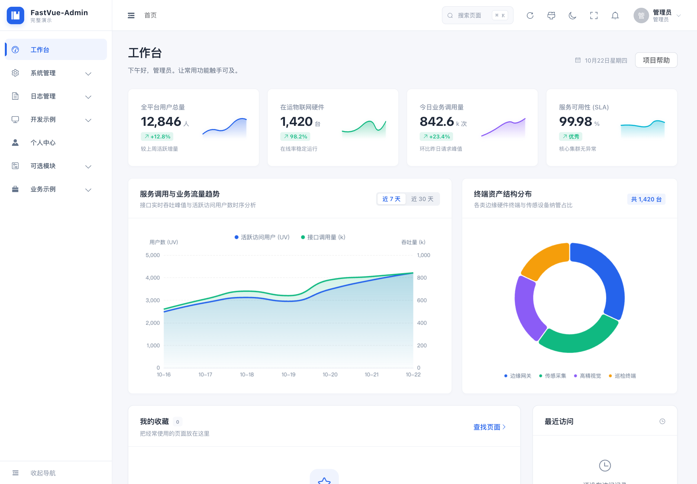
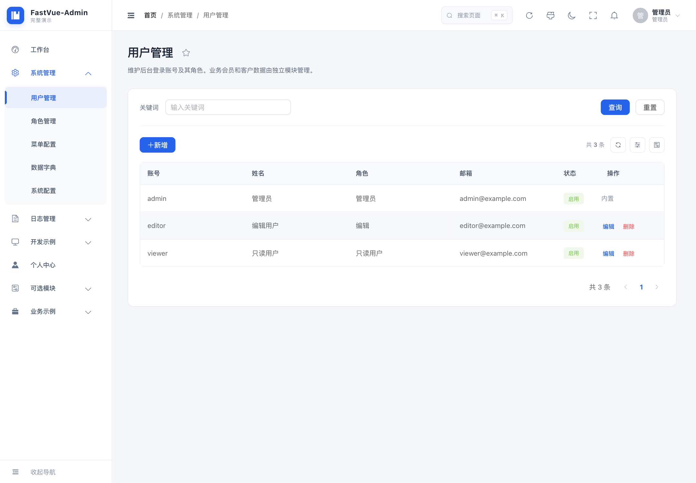
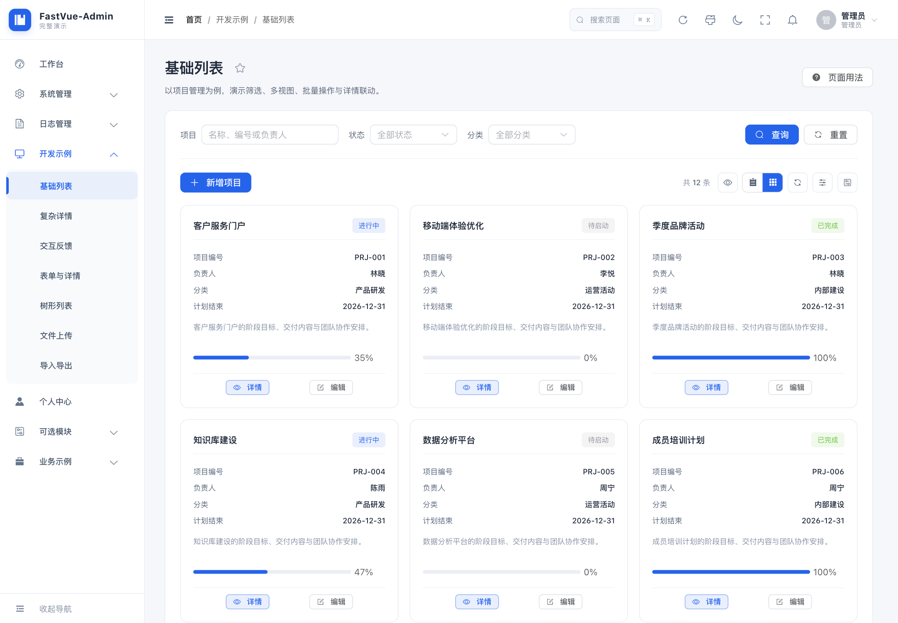
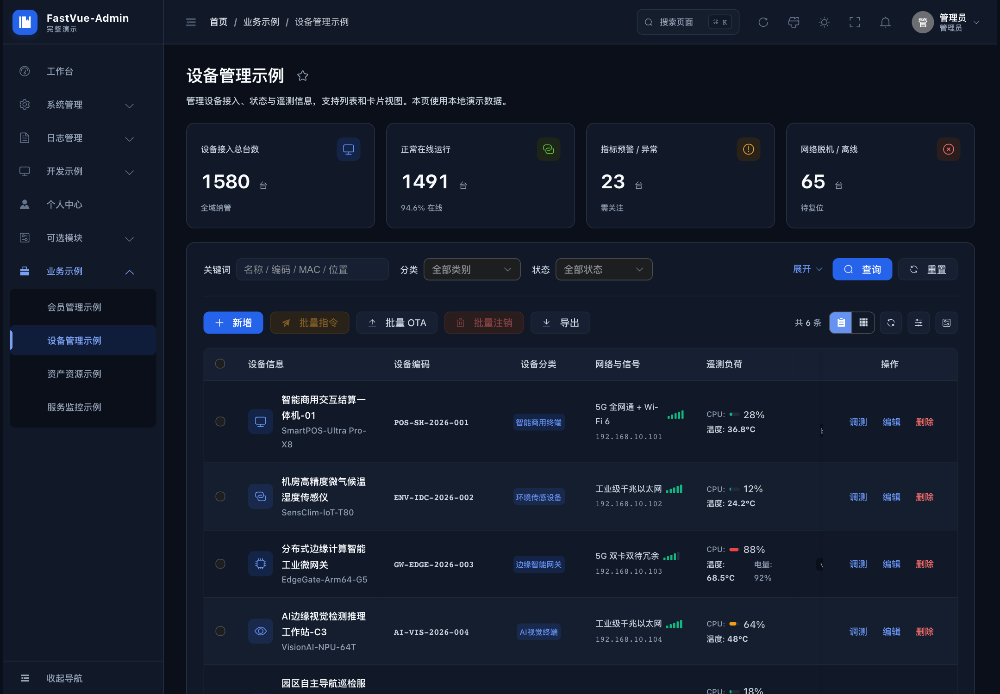
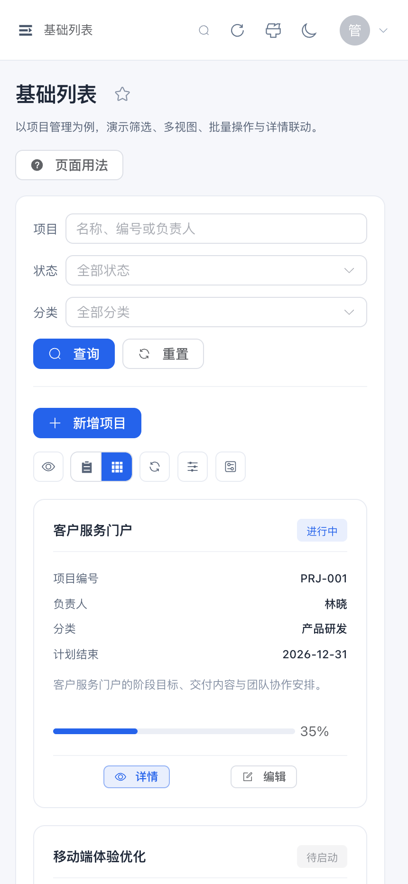

# FastVue-Admin

<p align="center">
  
  
  
  
  
  
  
</p>

基于 **Vue 3、Element Plus、Pinia、Vite** 与 **FastAPI、SQLAlchemy、PostgreSQL、Redis** 的现代化企业级后台脚手架。

原生不绑定特定垂直行业（设备、资产或特定企业模型），专注于提供通用而优雅的底座，适合在此基础上高效自研内容、运营、电商、企业协同及内部管理后台。

---

## 📸 界面效果与本地体验

> [!NOTE]
> 🌐 **在线演示环境**：公网在线 Demo 正在筹备部署中。推荐在本地使用**纯前端 Mock 模式**秒级启动，无需安装配置任何数据库，直接开箱体验完整增删改查：
> ```bash
> cd frontend && npm ci && npm run dev
> ```
> 浏览器打开 [http://localhost:5173](http://localhost:5173) 即可进入系统。

系统已内置多维度视觉体验：

- **🌞 亮色模式 (Light)**：清爽典雅的蓝白质感，统一的表格间距、筛选栏高度与紧凑度。
- **🌙 暗色模式 (Dark)**：舒适护眼的暗黑配色，搭载原生视图过渡的圆形向外扩散动效。
- **📱 移动端自适应 (Mobile)**：侧边栏抽屉折叠、移动端卡片自适应缩放与触控友好交互。
*(可在本地启动后点击右上角主题切换按钮，或在浏览器开发者工具中开启移动设备仿真进行体验)*

以下截图来自 **Full 模式的本地 Mock 环境**，内容均为演示数据。截图文件保存在仓库内，点击可查看原图。

### 工作台



### 用户管理与项目卡片

<table>
  <tr>
    <th width="50%">用户管理</th>
    <th width="50%">项目卡片视图</th>
  </tr>
  <tr>
    <td></td>
    <td></td>
  </tr>
</table>

### 暗色模式



<details>
  <summary>📱 移动端预览（展开查看）</summary>
  <p align="center">
    
  </p>
</details>

---

## ⚡ Starter vs Full 模式差异

FastVue-Admin 内置两套预设模式，兼顾“快速二次开发自研”与“复杂业务模式参考”：

| 对比维度 | 🚀 Starter（精简起步模式，推荐自研） | 📦 Full（完整业务演示模式） |
| :--- | :--- | :--- |
| **定位用途** | **最纯粹的二开骨架**，剥离垂直业务逻辑，便于从零打造新系统 | **全功能综合展示**，包含大量复杂业务 UI 模板供临摹参考 |
| **预设菜单模块** | 仪表盘工作台、用户/角色/字典/系统设置/日志/个人中心、开发示例通用组件 | 在 Starter 基础上额外包含：**会员管理、设备运维、资产流转、服务监控看板、部门组织树** |
| **本地启动** | `npm run dev` | `npm run dev:full` |
| **构建发布** | `npm run build` | `npm run build:full` |
| **打包体积** | 仅打包通用管理代码，体积轻巧无冗余 | 包含全部行业模板组件 |
| **后端范围** | 全面支持真实 FastAPI + PostgreSQL 接口对接 | 行业拓展页使用前端本地 Mock 供 UI 交互预览 |

---

## ✨ 核心特性

- **开箱即用的系统管理**：用户管理、角色管理（RBAC 逐接口/按钮权限）、数据字典、系统设置、审计日志与个人中心（含头像与登录会话管理）。
- **独立的产品用户认证**：手机号注册、密码或短信登录、双令牌刷新、重置密码、基础资料维护与注销账号；产品用户与后台账号、角色及会话分开，附带 HTML 联调测试台。
- **配置驱动的模块体系**：菜单、路由与访问权限共用模块声明（`src/config/modules.js`），自动装配侧边栏与面包屑。
- **可复用的开发示例**：项目列表、卡片、分步表单和详情共享示例数据；提供树形目录维护、图片裁剪、模拟上传重试、CSV 重复处理及交互反馈。各页“页面用法”提供源码位置和接入说明，详见 [示例复用指南](docs/development.md#开发示例复用)。
- **现代化交互与操作效率**：
  - `⌘/Ctrl + K` 全局快捷搜寻页面与常用功能。
  - 收藏夹与最近访问历史记录。
  - 表格列显隐、列宽及查询条件自动持久化存储。
  - 圆形向外扩散的无闪烁平滑暗黑模式过渡动画。
- **灵活的数据双轨架构**：
  - **无依赖纯前端 Mock**：无需安装数据库即可完整体验全部增删改查。演示数据及个人图片保存在浏览器 IndexedDB 中，旧版 localStorage 数据会自动迁移，迁移成功后才清理旧副本。
  - **生产级后端 API**：基于 FastAPI、SQLAlchemy 异步 ORM、PostgreSQL 与 Alembic 数据库迁移。
- **工程化与质量保证**：完善的 GitHub Actions 持续集成自动化测试、Ruff 代码规范检查、RFC 4180 CSV 状态机解析与 Docker Compose 容器编排。

---

## 🚀 快速启动

### 方式一：纯前端启动（免后端/开箱即用）
建议使用 Node.js 22.12+ 和 npm。在仓库根目录执行：

```bash
cd frontend
npm ci
npm run dev        # 启动 Starter 精简模式
# 或 npm run dev:full  # 启动 Full 完整演示模式
```

默认访问地址为 [http://localhost:5173](http://localhost:5173)。

演示账号说明：

| 账号 | 密码 | 权限 |
| :--- | :--- | :--- |
| **admin** | admin123 | 超级管理员，拥有全部权限 |
| **editor** | editor123 | 编辑员，可维护用户与字典 |
| **viewer** | viewer123 | 只读用户，仅可查看 |

---

### 方式二：全栈启动（FastAPI + PostgreSQL + Redis）

1. **环境准备与依赖安装**：
   后端使用现代 Python 包管理器 `uv`（Python 3.12+）：
   ```bash
   cd backend
   uv sync --locked
   ```

2. **数据库初始化与启动**：
   准备 PostgreSQL；使用产品用户认证时还需 Redis。复制配置模板，填入真实数据库连接和独立签名密钥，再执行迁移与管理员初始化：
   ```bash
   cp .env.example .env
   # 编辑 backend/.env：DATABASE_URL 必填；产品认证需配置 REDIS_URL、USER_JWT_SECRET
   # 生成随机签名密钥，将输出填入 USER_JWT_SECRET
   uv run --locked python -c "import secrets; print(secrets.token_urlsafe(32))"
   uv run --locked manage.py setup   # 自动完成 alembic upgrade head 并初始化 admin 账号
   uv run --locked manage.py dev     # 启动后端服务 (端口 8001)
   ```

3. **前端对接真实后端**：
   在 `frontend/.env.local` 中配置：
   ```ini
   VITE_USE_MOCK=false
   VITE_API_BASE_URL=/api/v1
   ```
   重新执行 `npm run dev` 即可，Vite 开发服务器会自动将 `/api/v1` 代理至本地 `http://127.0.0.1:8001`。
   后端文档：[Swagger](http://127.0.0.1:8001/docs)。

`DATABASE_URL` 没有默认值，可通过 `backend/.env` 或进程环境变量提供。缺失或格式无效时直接退出；配置有效后仍会检查数据库连接、迁移版本及初始化状态。真实后台管理员密码在首次初始化时设置，与纯前端演示密码独立。

---

### 方式三：Docker Compose 一键容器化部署

根目录提供了生产就绪的容器编排：

```bash
# 1. 复制环境变量模板，设置 POSTGRES_PASSWORD 和独立的 USER_JWT_SECRET
cp .env.example .env

# 2. 首次运行：执行数据库迁移与管理员账号初始化 (需 tools profile)
docker compose --profile tools run --rm init

# 3. 启动常驻服务集群 (PostgreSQL, Redis, FastAPI API, Nginx Web)
docker compose up -d

# 4. 服务入口
# 前端 Web 界面：http://localhost:8080
# API 健康检查：http://localhost:8080/api/health
# Compose 不对宿主机开放 API 8001 端口；接口通过 Web 的 /api 路径访问
```

---

## 账号系统与接口

| 范围 | 管理后台 | 产品用户 |
| --- | --- | --- |
| 认证接口 | `/api/v1/admin/auth/*` | `/api/v1/user/auth/*` |
| 当前账号 | `/api/v1/admin/me` | `/api/v1/user/me` |
| 账号表 | `admin_accounts` | `users` |
| 认证方式 | 数据库 Bearer 会话、RBAC | JWT 访问令牌、Redis 刷新会话 |

后台账号管理使用 `/api/v1/admin/accounts`，角色使用 `/api/v1/admin/roles`，角色表为 `admin_roles`。两套令牌互不通用；Full 模式中的会员管理仍是前端业务示例。
后端按 `admin/`、`user/` 分目录，例如 `/api/v1/admin/accounts` 对应 `backend/app/api/v1/admin/accounts.py`；模型和服务按相同业务域组织，仅接口层包含版本目录。

已有环境升级时先停止后端并备份数据库，再在 `backend/` 执行 `uv run --locked manage.py setup`，完成迁移后重新部署前后端。迁移保留已有数据；旧 `/api/v1/auth/*`、`/api/v1/users`、`/api/v1/app/*` 路径已移除，前端更新后需重新登录。

### 产品认证联调测试台

保留 [user-auth-tester.html](backend/tools/user-auth-tester.html)，可测试验证码、注册、登录、刷新、资料、退出和注销接口。在后端正常运行后，另开终端执行：

```bash
cd backend
python3 -m http.server 5174 --directory tools
```

打开 [联调测试台](http://localhost:5174/user-auth-tester.html)，后端地址填写 `http://localhost:8001`，工具会自动附加 `/api/v1/user`。使用 5174 时，需在 `backend/.env` 的 `CORS_ORIGINS` JSON 数组中加入 `http://localhost:5174`，然后重启后端。
默认 CORS 放行 `localhost`、`127.0.0.1` 的 5173 与 IDE 63342 端口；也可直接使用这些端口提供页面。不要双击以 `file://` 打开。

短信模拟默认关闭。本地联调可显式设置 `USER_SMS_MOCK_ENABLED=true`，使用任意六位数字且不发送真实短信；生产环境禁止开启。测试凭证保存在浏览器 localStorage，请使用测试账号。详见 [产品用户认证文档](backend/docs/user-auth.md)。

---

## 📖 开发与学习文档

- 🌟 **[从零开发“公告管理”端到端实战教程](docs/tutorial-notice.md)**：**强烈推荐！** 严格按项目当前架构实测跑通：涵盖数据库模型迁移、FastAPI 接口开发、权限配置到 Vue3 页面交互构建的全流程。
- 📘 **[二次开发规范与脚手架扩展](docs/development.md)**：深入了解布局容器、表单草稿复用、表格偏好缓存等进阶能力。
- 🔌 **[后端接口约定与安全鉴权规范](docs/api.md)**：前后端通信协议、分页规范、错误码及鉴权规则。
- 🛡️ **[生产运维与容灾保障指南](docs/maintenance.md)**：链路 Request ID 机制、结构化错误日志、PostgreSQL 自动化备份与灾难恢复实操。
- 📱 **[产品用户认证与联调](backend/docs/user-auth.md)**：产品账号、Redis 会话、短信配置与独立测试台。
- 🛠️ **[后端架构与部署运维说明](backend/README.md)**：数据库连接池、Alembic 迁移机制与性能调优。

---

## 🗂️ 目录结构

```text
├── .github/               # GitHub Actions CI 工作流与社区协作模板
├── frontend/              # Vue 3 前端工程
│   ├── src/
│   │   ├── api/           # 统一请求层与接口方法
│   │   ├── config/        # 模块、路由、权限声明
│   │   ├── components/    # 页面容器、筛选面板等中后台通用组件
│   │   ├── composables/   # 表格偏好、RFC 4180 CSV 导入导出等复用逻辑
│   │   └── views/         # 页面视图（系统管理、业务模块与开发示例）
│   └── tests/             # 前端自动化测试用例 (含 CSV 解析测试)
├── backend/               # FastAPI 核心后端
│   ├── alembic/           # 数据库版本迁移脚本
│   ├── app/               # API、模型和服务按 admin/user 业务域组织
│   ├── tools/             # HTML 产品认证联调测试台
│   ├── docs/              # 产品认证部署与接口说明
│   └── tests/             # PostgreSQL 集成测试集
├── docs/                  # 开发文档、实操教程与运维手册
├── compose.yaml           # Docker Compose 生产与测试编排
└── CHANGELOG.md           # 版本演进与更新日志
```

---

## 🤝 参与贡献与社区

我们极其欢迎任何形式的贡献！无论是发现 Bug、提出 Feature 建议，还是提交优化代码：

- 提交代码前，请务必阅读 **[贡献指南 (CONTRIBUTING.md)](.github/CONTRIBUTING.md)**。
- 发现安全缺陷请参阅 **[安全策略 (SECURITY.md)](.github/SECURITY.md)** 进行负责任的私下披露。
- 查看最新版本演进与发布历史请阅读 **[更新日志 (CHANGELOG.md)](CHANGELOG.md)**。

提交前请确认本地验证通过：
```bash
cd frontend && npm test && npm run build && npm run build:full
cd ../backend && uv run ruff check . && uv run ruff format --check .
```

---

## 📄 开源许可

本项目采用 [MIT License](LICENSE)，版权归属为 `Copyright (c) 2026 DDiabolous`。
